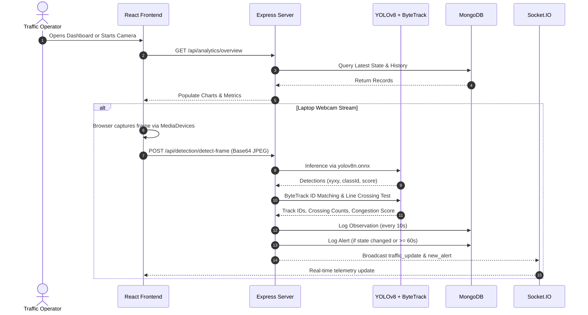

# Technical Architecture & Modernization Specification

## 5G Smart Campus Traffic Monitoring and Mobility Analytics System

---

## 1. System Overview

The **5G Smart Campus Traffic Monitoring and Mobility Analytics System** is an enterprise-grade Intelligent Transportation System (ITS) modernizing an initial Python/Streamlit prototype into a reactive, high-performance **React.js + Node.js + Express.js + MongoDB + Socket.IO** architecture.

The platform provides edge computer vision inference using **YOLOv8** object detection and **ByteTrack** multi-object tracking, real-time virtual line collision counting, weighted vehicle congestion classification, automated rate-limited incident alerts, and rolling machine learning traffic prediction (Linear Regression and Random Forest Regressor).

```
                      +-------------------------------------------+
                      |               React 19 Frontend           |
                      |  (Vite + Tailwind CSS + Recharts + Icons) |
                      +-------------------------------------------+
                                   |                 ^
                         HTTP REST |                 | WebSocket (Socket.IO)
                       (Axios API) |                 | (Live Telemetry / Alerts)
                                   v                 |
                      +-------------------------------------------+
                      |         Node.js + Express.js Backend      |
                      +-------------------------------------------+
                        |           |               |           |
                        v           v               v           v
                 +------------+ +--------+     +----------+ +-----------+
                 |   YOLOv8   | |ByteTrack|    | Analytics| | Prediction|
                 | ONNX Engine| | Tracker |    | & Alerts | |  Engine   |
                 +------------+ +--------+     +----------+ +-----------+
                                    |               |             |
                                    v               v             v
                      +-------------------------------------------+
                      |             MongoDB 9.0 Database          |
                      |   (TrafficHistory, TrafficAlert, Config)  |
                      +-------------------------------------------+
```

---

## 2. Directory Structure

```text
5G_Smart_Campus_Traffic_Updated_Laptop_USB_Sparsh_CCTV/
├── frontend/                                # Modern React.js Dashboard
│   ├── src/
│   │   ├── api/
│   │   │   └── apiService.js                # Centralized Axios REST client
│   │   ├── components/
│   │   │   ├── Navbar.jsx                   # Smart campus top bar & status pills
│   │   │   ├── Sidebar.jsx                  # Navigation links with badge counters
│   │   │   ├── MetricCard.jsx               # Stat cards with trend indicators
│   │   │   └── CongestionBadge.jsx          # Multi-tier congestion pill badges
│   │   ├── context/
│   │   │   └── TrafficContext.jsx           # Global state, Socket.IO subscription
│   │   ├── pages/
│   │   │   ├── OverviewDashboard.jsx        # Unified KPI dashboard & trends
│   │   │   ├── LiveCameraMonitoring.jsx     # Multi-source live streams (Laptop/USB/RTSP/Upload)
│   │   │   ├── TrafficAnalytics.jsx         # Category distributions, crossing bar charts
│   │   │   ├── CongestionMonitoring.jsx     # Vehicle weights & congestion breakdown
│   │   │   ├── FuturePrediction.jsx         # 5-min ML prediction, LR vs RF MAE
│   │   │   ├── TrafficAlerts.jsx            # Real-time alert feed & severity history
│   │   │   ├── CameraManagement.jsx         # Camera registration and endpoint config
│   │   │   └── SystemSettings.jsx           # Line height ratio, thresholds, multipliers
│   │   ├── App.jsx                          # Router configuration
│   │   ├── main.jsx                         # React entrypoint
│   │   └── index.css                        # Tailwind CSS styles
│   ├── package.json
│   ├── vite.config.js
│   └── tailwind.config.js
│
├── backend/                                 # Node.js + Express.js Server
│   ├── src/
│   │   ├── config/
│   │   │   └── db.js                        # Mongoose MongoDB connection
│   │   ├── models/
│   │   │   ├── TrafficHistory.js            # Historical 10s observations schema
│   │   │   ├── TrafficAlert.js              # Rate-limited alert log schema
│   │   │   ├── CameraConfig.js              # Managed camera sources schema
│   │   │   └── SystemSettings.js            # Thresholds and vehicle weights schema
│   │   ├── cv/
│   │   │   ├── yoloDetector.js              # ONNX Runtime YOLOv8 inference & NMS
│   │   │   ├── byteTrack.js                 # ByteTrack multi-object tracker
│   │   │   ├── lineCrossing.js              # Virtual line collision detector
│   │   │   └── cameraManager.js             # Pipeline coordinator & frame processor
│   │   ├── analytics/
│   │   │   ├── congestionAnalyzer.js        # Vehicle weights and congestion scoring
│   │   │   ├── alertManager.js              # Rate-limited alert trigger (60s cooldown)
│   │   │   └── trafficPredictor.js          # Feature engineering, LR & RF models
│   │   ├── controllers/
│   │   │   ├── cameraController.js
│   │   │   ├── detectionController.js
│   │   │   ├── analyticsController.js
│   │   │   ├── predictionController.js
│   │   │   ├── alertController.js
│   │   │   └── settingsController.js
│   │   ├── routes/
│   │   │   └── apiRoutes.js                 # Express REST endpoint router
│   │   ├── sockets/
│   │   │   └── socketManager.js             # Real-time WebSocket broadcasting
│   │   ├── middleware/
│   │   │   └── upload.js                    # Multer video upload handler
│   │   ├── utils/
│   │   │   └── seedData.js                  # CSV-to-MongoDB migration script
│   │   └── server.js                        # Main application bootstrap
│   ├── .env                                 # Environment variables
│   └── package.json
│
├── 5G_Smart_Campus_Traffic_Dual_Input/      # Original Python/Streamlit Project (Preserved)
│   ├── app.py
│   ├── app_phase4_updated.py
│   ├── yolov8n.pt                           # PyTorch weights
│   ├── yolov8n.onnx                         # Exported ONNX weights (12.2 MB)
│   ├── data/
│   │   ├── traffic_history.csv
│   │   └── traffic_alerts.csv
│   └── src/
│       ├── traffic_processor.py
│       ├── congestion_analyzer.py
│       ├── traffic_predictor.py
│       └── alert_manager.py
│
├── docs/
│   └── architecture.md
└── README.md
```

---

## 3. Data Flow Between Modules



---

## 4. Mathematical Formulations & Algorithms

### 4.1 Bounding Box Centroid & Virtual Line Crossing
For an object with bounding box coordinates $[x_1, y_1, x_2, y_2]$:
$$c_x = \left\lfloor \frac{x_1 + x_2}{2} \right\rfloor, \quad c_y = \left\lfloor \frac{y_1 + y_2}{2} \right\rfloor$$

Given frame height $H$ and virtual line position ratio $r = 0.55$:
$$y_{\text{line}} = \lfloor H \times 0.55 \rfloor$$

A crossing event occurs when an active track moves across $y_{\text{line}}$:
$$\text{Crossed} \iff (y_{\text{prev}} < y_{\text{line}} \le c_y) \;\lor\; (y_{\text{prev}} > y_{\text{line}} \ge c_y)$$

Deduplication guarantees that each tracking ID is counted at most once:
$$\text{If Crossed and } \text{trackId} \notin \text{countedIds} \implies \text{counts}[\text{class}] \leftarrow \text{counts}[\text{class}] + 1$$

### 4.2 Weighted Congestion Score
Vehicle categories are weighted according to transit footprint:
- Car: $1.0$
- Motorcycle: $0.5$
- Bus: $2.5$
- Truck: $2.0$
- Bicycle: $0.4$
- Pedestrian: $0.0$ *(Separated from vehicle congestion calculation)*

$$\text{Total Vehicles} = N_{\text{car}} + N_{\text{motorcycle}} + N_{\text{bus}} + N_{\text{truck}} + N_{\text{bicycle}}$$
$$\text{Traffic Score} = 1.0 N_{\text{car}} + 0.5 N_{\text{motorcycle}} + 2.5 N_{\text{bus}} + 2.0 N_{\text{truck}} + 0.4 N_{\text{bicycle}}$$

$$\text{Congestion Level} = \begin{cases}
\mathbf{NO\;DATA}, & \text{if } \text{Total Vehicles} = 0 \\
\mathbf{LOW}, & \text{if } 1 \le \text{Total Vehicles} \le 5 \\
\mathbf{MODERATE}, & \text{if } 6 \le \text{Total Vehicles} \le 15 \\
\mathbf{HIGH}, & \text{if } \text{Total Vehicles} > 15
\end{cases}$$

### 4.3 5-Minute ML Prediction Engine
- Sampling interval: $\Delta t = 10\text{ seconds}$.
- Time horizon: $T = 5\text{ minutes} = 300\text{ seconds} \implies K = 30\text{ samples}$.
- Target variable: $y_t = \text{vehicle\_count}_{t + 30}$.
- Features:
  - $x_{t, 1} = \text{vehicle\_count}_t$
  - $x_{t, 2} = \text{mean\_1m}_t = \frac{1}{6} \sum_{i=0}^5 \text{vehicle\_count}_{t - i}$
  - $x_{t, 3} = \text{mean\_3m}_t = \frac{1}{18} \sum_{i=0}^{17} \text{vehicle\_count}_{t - i}$
  - $x_{t, 4} = \text{trend\_1m}_t = \text{vehicle\_count}_t - \text{vehicle\_count}_{t - 5}$
- Validation: Chronological $80\%$ training set, $20\%$ test set.
- Algorithms:
  1. Linear Regression (OLS closed-form solution: $\mathbf{\beta} = (\mathbf{X}^T \mathbf{X})^{-1} \mathbf{X}^T \mathbf{y}$).
  2. Random Forest Regressor (Ensemble of regression trees with bootstrap sampling and feature sub-sampling).
- Model Selection: $\min(\text{MAE}_{\text{LR}}, \text{MAE}_{\text{RF}})$.

---

## 5. REST API Specifications

| Method | Route | Description |
| :--- | :--- | :--- |
| `GET` | `/api/health` | Service health status and ping |
| `GET` | `/api/cameras` | List configured cameras |
| `POST` | `/api/cameras` | Register new camera |
| `POST` | `/api/cameras/:id/start` | Start camera processing pipeline |
| `POST` | `/api/cameras/:id/stop` | Stop camera processing pipeline |
| `POST` | `/api/detection/detect-frame` | Process single frame with YOLOv8 & ByteTrack |
| `POST` | `/api/detection/upload-video` | Upload and process video clip |
| `GET` | `/api/crossings` | Get line-crossing counts |
| `POST` | `/api/crossings/reset` | Reset crossing counters |
| `GET` | `/api/congestion/current` | Get current congestion level and weighted score |
| `GET` | `/api/traffic-history` | Query historical observations |
| `GET` | `/api/predictions/current` | Get latest 5-minute prediction and model MAEs |
| `POST` | `/api/predictions/train` | Retrain ML prediction models |
| `GET` | `/api/alerts` | Query alert log history |
| `GET` | `/api/analytics/overview` | Aggregated dashboard KPI telemetry |
| `GET` | `/api/settings` | Read system settings |
| `PUT` | `/api/settings` | Update system settings |

---

## 6. Real-Time Socket.IO Protocol

| Event | Direction | Purpose |
| :--- | :--- | :--- |
| `client_frame` | Client $\to$ Server | Submits webcam frame for server-side inference |
| `traffic_update` | Server $\to$ Client | Broadcasts counts, crossings, score, and congestion status |
| `detection_boxes` | Server $\to$ Client | Emits tracked bounding boxes and tracking IDs |
| `new_alert` | Server $\to$ Client | Broadcasts new high/moderate traffic alerts |
| `prediction_update` | Server $\to$ Client | Emits retrained model predictions |
